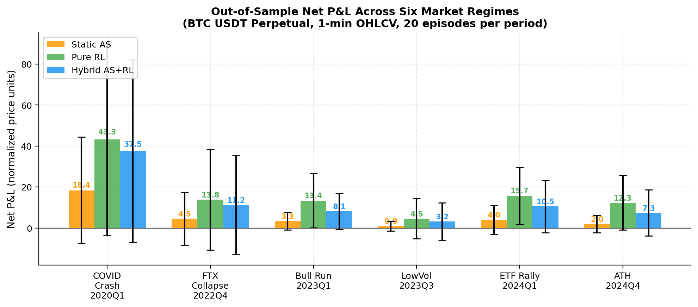
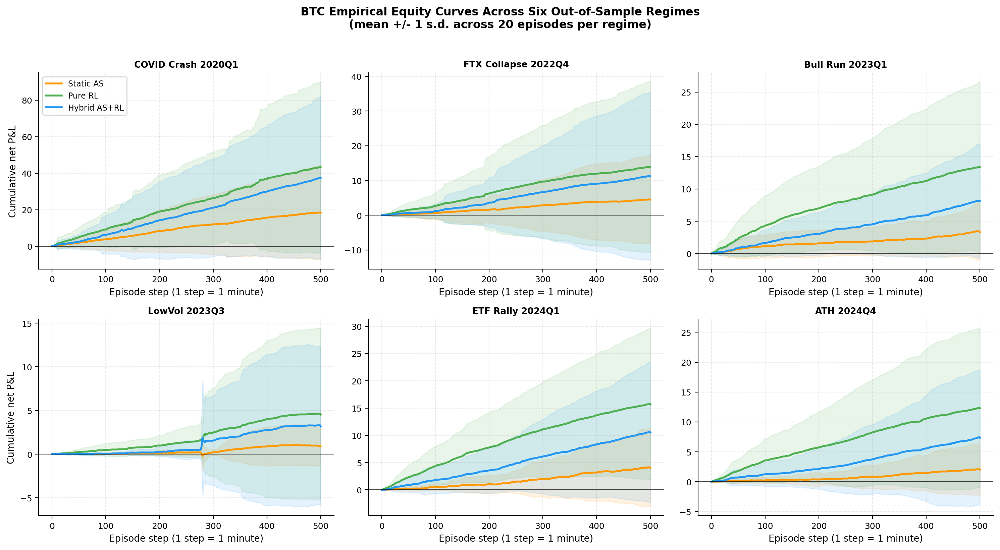
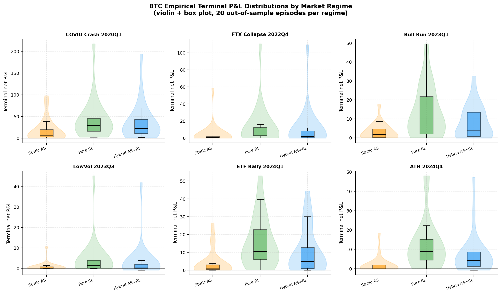

<div align="center">

# Hybrid AS + Reinforcement Learning

Market-making experiments with an Avellaneda–Stoikov backbone and PPO.

  

[Quick start](#quick-start) · [Project map](#project-map) · [Reproduction guide](docs/REPRODUCIBILITY.md)

</div>

---

## Overview

Compare a calibrated static Avellaneda–Stoikov benchmark, a pure reinforcement-learning policy, and a hybrid policy that learns corrections around the AS backbone.

| Experiment | Environment | Entry point |
|---|---|---|
| Empirical study | BTC 1-minute OHLCV replay | `project/train_data.py` |
| Synthetic comparison | Stylized limit-order-book simulation | `project/train_ppo.py` |
| Reporting | Figures and summary tables | `project/make_figures.py` |

## Visual results



| Equity curves | Terminal PnL distributions |
|---|---|
|  |  |

## Quick start

Set `DATA_PATH` in `project/train_data.py` to your BTC CSV path, then run from the repository root:

```powershell
python -m pip install -r requirements.txt
Set-Location project
python train_data.py
python make_figures.py
```

Use `python train_ppo.py` for the synthetic experiment. The empirical CSV should provide chronological `timestamp`, `open`, `high`, `low`, `close` and `volume` columns matching the loader.

## Project map

| Path | Role |
|---|---|
| [project/agents/ppo.py](project/agents/ppo.py) | PPO policy and trainer |
| [project/envs/lob_data_env.py](project/envs/lob_data_env.py) | Minute-bar replay environment |
| [project/envs/lob_env.py](project/envs/lob_env.py) | Synthetic simulation |
| [project/models/avellaneda_stoikov.py](project/models/avellaneda_stoikov.py) | AS benchmark and backbone |
| [project/results/](project/results/) | Committed figures, tables and model artifacts |

## Interpreting the experiments

The empirical environment approximates fills using OHLC crossings; it is not full L2 or exchange-queue replay. Episode prices are normalized to `S0 = 100`.

The configured training window is June 2020–September 2022. The March–April 2020 COVID regime precedes that window and is a **retrospective stress test**, rather than a chronological forward test.

Training outputs are generated under `project/outputs/`. Rebuilding figures may require raw data and additional checkpoints. Detailed experimental settings are preserved in [the research reference](docs/PROJECT_REFERENCE.md).

## Documentation

- [Reproduction guide](docs/REPRODUCIBILITY.md): inputs, execution order and validation limits.
- [Code and artifact map](docs/REPOSITORY_MAP.md): source and configuration paths.

<sub>Research artifacts reflect the recorded experiment settings. Full results were not regenerated during documentation cleanup.</sub>
